# Level audit: all 40 maps before the redesign

Audit only. No geometry, course data or `src/` file was changed. The owner asked for an honest look at every map before redesigning all of them once the current visual work lands. This document records what each map is today, what the existing solver evidence says about it, and where its design falls short. It ends with a proposed redesign order and design principles for the owner to approve.

## Method and evidence

- **Course data:** `createCourseData()` from `src/courses/index.js` on main `a315407`. Coordinates are simulation units: x right, y down in the images, z up. Chambers in the 3 × 2 maps are about 228 × 192 inside their walls. Lane maps (2 × 3) use lanes of about 348 × 128.
- **Images:** one top-down PNG per map in [level-audit/](level-audit/), rendered by [level-audit/render.mjs](level-audit/render.mjs) (SVG rasterised by Playwright at deviceScaleFactor 1 and reduced to 48 colours; 428 KB in total). White squares mark tees and black-centred circles mark cups, numbered by putt. Dashed lines trace the recorded solver route at hazard time 0: long dashes for the first stroke, short dots for later strokes. Only maps 22–39 and Grand Finale putts 1 and 3 have recorded routes. Key: dark brown = wall, near-black = pit or crater, orange = ramp (the arrow points uphill; `0→30 L` means rising from z 0 to z 30 with a launch profile), violet = raised platform (`z24` is its height), pink J = jump pad, purple ring = portal (pairs share a number), blue dashed box = fan (arrow shows the push), orange dashed box = wind zone, grey disc = tornado (inner ring = lift core), red bar = moving block (pale box = its travel), sand / pale blue ice / lime slime, yellow `?` = power-up block.
- **Par evidence (not re-measured):**
  - Maps 22–39: [tests/fixtures/world-maps/par-routes.json](../../tests/fixtures/world-maps/par-routes.json) (SV1 fast search, each map at its own world's gravity). `node tests/world-maps.test.cjs` passed on this branch: the report is current and replays (Gaia 12 putts, 11 one-stroke; Ares 48, 42 one-stroke; Luna 48, 41 one-stroke).
  - Maps 0–21: the Q1 fast sweep summarised in [Q1_RELEASE.md](Q1_RELEASE.md) (robust 1-stroke routes unless listed), and the B4 full-grid hit counts in [tests/fixtures/difficulty-b4.json](../../tests/fixtures/difficulty-b4.json) for the six legacy starter maps. A B4 count is the number of grid shots (720 angles × 15 powers = 10,800 per putt) that sink in one stroke. B4 predates the S3 physics retune, so the counts show relative forgiveness only.
  - Known gaps: Comet Run (18) has no robust route with the full grid exhausted; Clockwork Maze (4) ran out of its trial budget. Hourglass (13) needs 3 strokes against par 3, and Crescent Coast (16) needs 4 against par 5 (both found only with `--full`).
- **No solver sweeps were run for this audit.** The facts that needed no new measurement came from course data (`node tools/cli/main.mjs check` passes on all 40 maps).
- **Playable pool:** `STARTER_COURSE_INDICES` (src/shared/constants.js) is 0, 5, 8, 19, 20, 21 and 22–39. The 16 single-putt legacy maps (1–4, 6, 7, 9–18) sit on the Gaia atlas (`REGION_COURSES`), but map cards and votes do not offer them (Q1_RELEASE.md).

**Scores** are 1–5 (5 is best) on four axes. **Fun:** would a group enjoy replaying it? **Clarity:** can a player read the route, tee and cup from the tee? **Fairness:** are failures caused by the player, not by unseen, timing-based or off-edge hazards? **Variety:** do the six putts differ from each other and from other maps? These are design judgements from the data and images, not playtest results. **Verdicts:** *keep with tweaks*, *rework* (keep the theme and some putts, rebuild the layout) or *replace* (start again; reuse the name or idea at most).

**Par notation:** "R" is the recorded robust route length, so `R 1/1/1/1/1/1` means every putt has a robust hole-in-one. `*` marks a putt whose route has no slack (route length equals par).

## Gaia

Gaia has 24 maps in six regions. Only 8 of them are six-putt maps that players can actually choose: 0, 5, 8, 19, 20 and 21 (legacy) and 22 and 23 (VIS-G). The other 16 are legacy single-putt holes on bare floating tiles. They do not fit the six-putt match format and no mode offers them. Gaia's real playable content is therefore 8 maps, and 5 of those share one chamber template (see "Cross-map findings").

### 0 · Switchback Garden: temperate

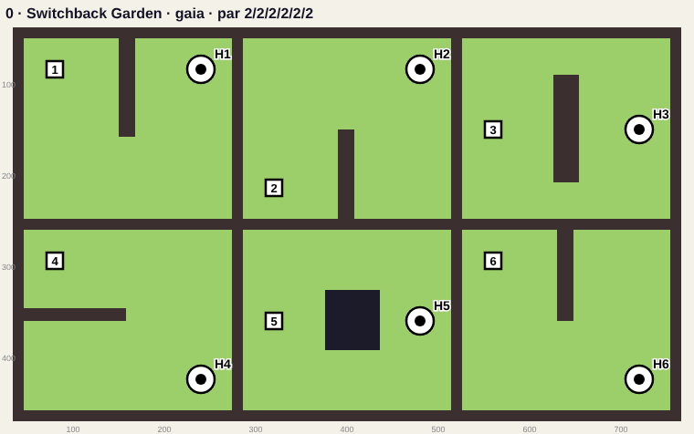

- **Mechanics:** walls; one pit (376,322 60×66).
- **Par:** 2 on all six putts (12). R 1 on every putt (Q1). B4: 768–1251 of 10,800 grid shots sink per putt, the most forgiving map in the game.
- **Problems:**
  - All six putts use one idea: tee on the left of a chamber, cup on the right, and one wall stub between them. Putts 1, 3 and 5 are 160 units straight across; putts 2, 4 and 6 are the same 206-unit diagonal.
  - The pit in putt 5 sits beside the line, not on it, so it never threatens.
  - Most of each chamber is dead lawn: putt 1 uses the top 60 units of a 192-unit chamber.
  - It is a fine first tutorial hole but repeats the lesson six times.
- **Scores:** fun 2 · clarity 5 · fairness 5 · variety 1.
- **Verdict:** **rework**. Keep it as the gentle opener, with six different teaching putts (bank, pit carry, gentle slope, chicane).

### 1 · Clover Crossing: temperate (single putt, not in pool)

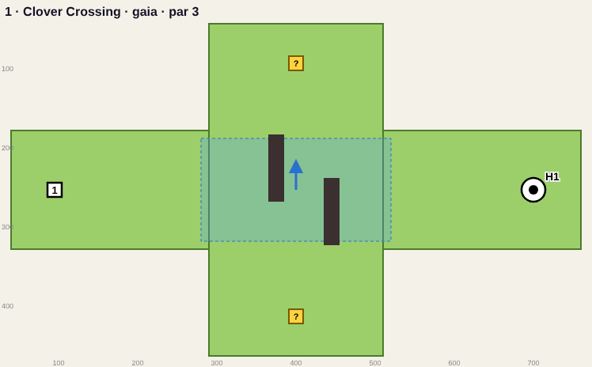

- **Mechanics:** a crosswind fan over the hub (280,185 240×130, pushing north at 170); two staggered walls (365,180) and (435,235) form a chicane.
- **Par:** 3; R 2.
- **Problems:**
  - The north and south lobes (290,40 and 290,325, each 220×135) hold only the two `?` blocks: about 60,000 square units of dead space.
  - There are no edge walls. The fan's only effect is to push the ball north off the line, so the hole is "fight the fan" once.
- **Scores:** fun 2 · clarity 3 · fairness 3 · variety 1.
- **Verdict:** **replace**. The chicane-under-crosswind idea is worth one putt in a six-putt map.

### 2 · Moonshot: polar (single putt)

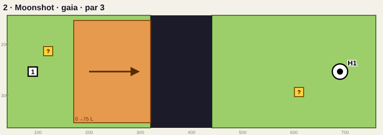

- **Mechanics:** a launch ramp (170,150 150×200, 0→75) over a 120-unit gap (x 320–440).
- **Par:** 3; R 1.
- **Problems:**
  - One full-power shot is the whole hole.
  - It sits in the polar region but has no ice and no cold identity.
- **Scores:** fun 2 · clarity 5 · fairness 3 · variety 1.
- **Verdict:** **replace** (the idea becomes one putt).

### 3 · Portal Archipelago: tropical (single putt)

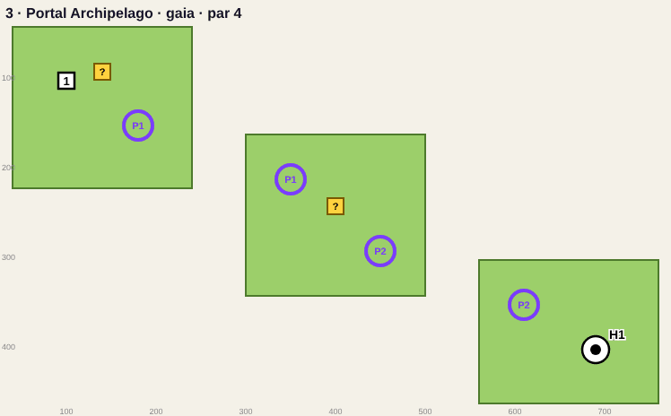

- **Mechanics:** three unwalled islands; portal pairs P1 (180,150)→(350,210) and P2 (450,290)→(610,350).
- **Par:** 4; R 1.
- **Problems:**
  - No island has a guard wall, so every overshoot is out of bounds.
  - The portals chain into a single straight line, so the hole is "roll into the ring" twice.
  - Nothing tells the player where P2's exit lands until they try it.
- **Scores:** fun 2 · clarity 2 · fairness 2 · variety 2.
- **Verdict:** **replace**.

### 4 · Clockwork Maze: temperate (single putt) · *known gap*

- **Mechanics:** three long walls (x 184, 364 and 544) that make a serpentine; two moving blocks: (270,390), sweeping 30 in y, and (480,100), sweeping 28.
- **Par:** 6; **no robust route** (trial budget exhausted, Q1).
- **Problems:**
  - It is a 725-unit serpentine with no perimeter walls (the whole 720×420 tile edge is open).
  - The movers sit in the turns, so success depends on when the ball arrives, which the player cannot plan from the tee.
  - Long corridors with nothing in them.
  - It is the slowest map in the set, for little decision-making.
- **Scores:** fun 1 · clarity 3 · fairness 1 · variety 1.
- **Verdict:** **replace**.

### 5 · Cyclone Ring: wetland

- **Mechanics:** four fans and four tornadoes; cups shrunk to radius 14, 9, 11, 11, 10 and 8 (default 15).
- **Par:** 4, 3, 4, 4, 4, 4 (23). R 1 on every putt (Q1), so par is 2–3 strokes generous. B4: 222–649 sinking shots per putt.
- **Problems:**
  - Fans sit directly on top of cups. Putt 1's fan (164,46 110×60) covers H1 (224,72) and pushes south; putt 3's fan (676,146 78×98) covers H3 (724,216) and pushes west; putt 6's narrow fan (644,366 32×88, strength 200) blows up a slot beside H6. A fan on the cup reads as noise, not a route choice.
  - Putt 2's tornado (426,136 r60) does straddle its line, but putt 5's (342,416 r40) sits about 100 units below its line and never comes into play.
  - The 8–11 unit cups make the difficulty come from cup size, not from course reading.
  - It uses the shared chamber template (tee/cup pairs identical to Dune Serpent, Frost Hollow and Grand Finale).
- **Scores:** fun 3 · clarity 2 · fairness 3 · variety 2.
- **Verdict:** **rework**. Keep the wind theme, move fans and tornadoes onto the route, and restore readable cups.

### 6 · Skybridge: polar (single putt)

- **Mechanics:** a ramp (160,170, 0→50) up to a narrow 80-wide bridge at z 50; a crosswind fan (330,210 180×80, pushing south at 85) along the bridge; a raised green at z 50.
- **Par:** 4; R 1.
- **Problems:**
  - It is the only legacy hole that uses height well, and it is the most "Putt Planet" idea in the old set.
  - The bridge has no guard walls, and the fan pushes straight off its south edge into the void: a cheap fail until the player learns to aim north.
  - It is in the polar region with no ice.
- **Scores:** fun 3 · clarity 4 · fairness 2 · variety 2.
- **Verdict:** **rework**, as a putt inside a six-putt map, with a lip on the downwind side or a visible wind cue.

### 7 · Pinwheel: temperate (single putt)

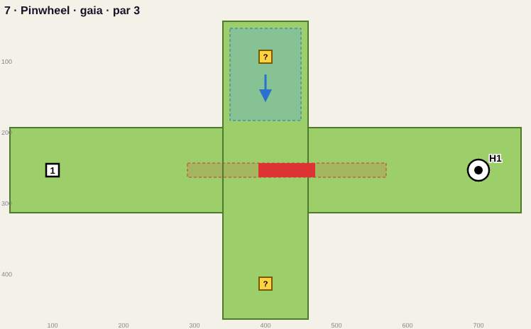

- **Mechanics:** a cross; a moving block (390,240 80×20) sweeping ±100 in x across the main lane; a fan in the north lobe (pushing south at 220).
- **Par:** 3; R 2.
- **Problems:**
  - The mover crosses the only line to the cup, so it is a timing gate the player cannot see coming.
  - The north and south lobes are dead space apart from `?` blocks.
- **Scores:** fun 2 · clarity 3 · fairness 2 · variety 1.
- **Verdict:** **replace**.

### 8 · Dune Serpent: desert

- **Mechanics:** walls and six small sand patches (40–50 units).
- **Par:** 2, 3, 2, 3, 3, 2 (15). R 1 on every putt. B4: 626–1040.
- **Problems:**
  - It is Switchback Garden with sand dots: tee/cup pairs are identical to Frost Hollow and match Cyclone Ring's on putts 1, 5 and 6.
  - Most sand patches sit off the line: putt 1's (196,116 50×60) is beside the bank, putt 6's (571,356) is behind the wall.
  - Only putt 3's long strip (626,46 30×198) crosses the route.
  - There is no "serpent": no winding path and no dune slopes.
- **Scores:** fun 2 · clarity 4 · fairness 5 · variety 1.
- **Verdict:** **replace**. The desert region needs real dunes: ramps, long sand traps and the Sandstorm Spire wind.

### 9 · Twin Peaks: polar (single putt)

- **Mechanics:** four ramps making two ridges: 0→60→0 and 0→45→0.
- **Par:** 4; R 2.
- **Problems:**
  - A straight lane with two humps. Reading pace over a crest is a good idea, but here it is the only one.
  - It has no walls, so an off-line shot rolls off the 220-wide lane.
  - Polar, no ice.
- **Scores:** fun 2 · clarity 5 · fairness 3 · variety 1.
- **Verdict:** **replace** (keep "pace over a crest" as one putt).

### 10 · Wind Tunnel: wetland (single putt)

- **Mechanics:** a C-shaped track of three unwalled strips; a tailwind fan (180,50, pushing east at 220) and a headwind fan (660,190, pushing north at 220) on the down leg.
- **Par:** 4; R 2.
- **Problems:**
  - The headwind on the right-hand leg pushes the ball back up toward the start, and nothing guards the inner edge, so most misses fall off.
  - The bottom strip (40,350 720×110) is 600 units of empty runway.
- **Scores:** fun 2 · clarity 3 · fairness 2 · variety 2.
- **Verdict:** **replace**.

### 11 · Fortress Spiral: desert (single putt)

- **Mechanics:** five walls forming a two-turn spiral to H1 (400,298).
- **Par:** 6; R 3.
- **Problems:**
  - A maze for its own sake: three careful straight putts along corridors.
  - The open lawn outside the spiral (the whole north strip and the east side) is dead space, and the tile edge has no walls.
  - The desert setting is unused.
- **Scores:** fun 2 · clarity 4 · fairness 4 · variety 1.
- **Verdict:** **replace**. A spiral works as one putt; Obsidian Spiral putt 2 already does it better.

### 12 · Bounce Harbor: tropical (single putt)

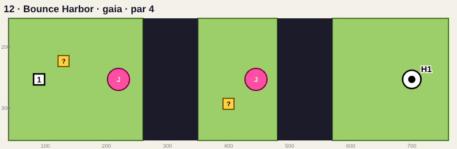

- **Mechanics:** two jump pads (220,250) and (445,250) in front of two 90-wide pits; three unwalled islands.
- **Par:** 4; R 1.
- **Problems:**
  - Pad, pit, pad, pit on one straight line: the shot is "aim at the pads".
  - The pads are 18-radius targets on the centreline, so the hole is solved by its symmetry.
- **Scores:** fun 2 · clarity 5 · fairness 3 · variety 1.
- **Verdict:** **replace**.

### 13 · Hourglass: desert (single putt) · *zero slack*

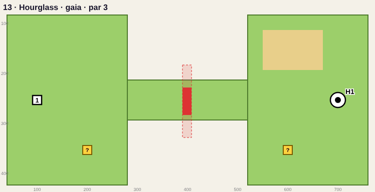

- **Mechanics:** a narrow neck (280,210 240×80) with a moving block (390,225 18×55, sweeping ±45 in y); a sand patch near the cup.
- **Par:** 3; route 3 (`--full` only).
- **Problems:**
  - The whole hole is the timing gate in the neck. The player cannot judge the block's phase from the tee on a 600-unit putt, so failure is luck.
  - The two bulbs are mostly empty.
- **Scores:** fun 1 · clarity 3 · fairness 1 · variety 1.
- **Verdict:** **replace**.

### 14 · Thunder Basin: wetland (single putt)

- **Mechanics:** two huge tornadoes of radius 125 (300,170 and 500,330, opposite spins); two wall stubs at x 364.
- **Par:** 4; R 1.
- **Problems:**
  - The tornadoes cover about 40% of the basin, and their pull is strongest where nothing is drawn (the visual reads as clouds, not forces).
  - It has a robust hole-in-one, so the big storm decides little.
- **Scores:** fun 3 · clarity 2 · fairness 3 · variety 2.
- **Verdict:** **rework** into one wetland putt with smaller, readable vortices.

### 15 · Portal Labyrinth: tropical (single putt)

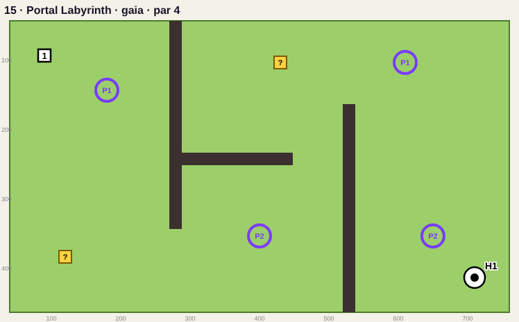

- **Mechanics:** three walls; portal pairs P1 (180,140)↔(610,100) and P2 (400,350)↔(650,350).
- **Par:** 4; R 2.
- **Problems:**
  - The portals are two-way and unlabelled in-game by destination.
  - P2's two ends are 250 apart on the same open floor, so it is a shortcut nobody needs.
  - The labyrinth is three walls.
- **Scores:** fun 2 · clarity 2 · fairness 3 · variety 2.
- **Verdict:** **replace**.

### 16 · Crescent Coast: tropical (single putt) · *needs --full*

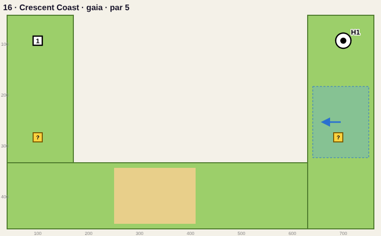

- **Mechanics:** a U of three unwalled strips; a sand trap (250,340 160×110); a fan on the final leg (640,180 110×140, pushing west at 120).
- **Par:** 5; route 4 (`--full` only).
- **Problems:**
  - The fan on the return leg pushes west, straight off the strip's open inner edge (x 630) into the void. It is the clearest cheap hazard in the game: the player does nothing wrong and the ball leaves the island.
  - The bottom strip is long and empty apart from the sand.
- **Scores:** fun 1 · clarity 3 · fairness 1 · variety 2.
- **Verdict:** **replace**.

### 17 · Elevator Alley: volcanic (single putt)

- **Mechanics:** a ramp (220,160, 0→65) to a z 65 deck; a moving block (510,230 24×75, sweeping ±45 in y) on the deck.
- **Par:** 4; R 2.
- **Problems:**
  - It has no elevator; the name promises a moving platform.
  - The mover is a timing gate on the deck, and the 180-wide alley has no walls.
  - Volcanic region, no lava or heat identity.
- **Scores:** fun 2 · clarity 4 · fairness 2 · variety 1.
- **Verdict:** **replace**.

### 18 · Comet Run: volcanic (single putt) · *known gap*

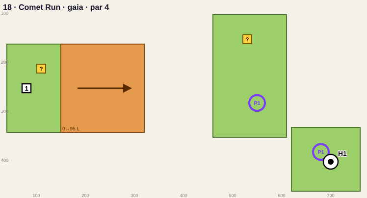

- **Mechanics:** a launch ramp (150,160 170×180, 0→95) that throws the ball across a void to a middle island; a portal P1 (550,280)→(680,380) next to the cup.
- **Par:** 4; **no robust route** (full grid exhausted, Q1).
- **Problems:**
  - The launch has to land on a 150×250 island 140 units away with no backstop, so tiny pace errors go out of bounds; this is why no shot is robust.
  - The portal exit (680,380) is beside H1 (700,400), so the portal does the putting.
- **Scores:** fun 1 · clarity 3 · fairness 1 · variety 2.
- **Verdict:** **replace**.

### 19 · Grand Finale: volcanic

- **Mechanics:** everything: three fans, five tornadoes, two portal pairs, two pads, ice and slime; cups radius 8–10.
- **Par:** 4 on every putt (24). Routes: putts 1 and 3 take 2 strokes (Q1; recorded in [par-route-gaps.json](../../tests/fixtures/cup-capture/par-route-gaps.json)); the rest are R 1. B4: 125–329, the hardest legacy starter.
- **Problems:**
  - It is a mechanic sampler, not a finale. Each chamber stacks two or three unrelated elements: putt 1 has ice, a cup fan and a wall; putt 6 has portals, a tornado, a pad and slime.
  - The recorded route for putt 1 (image) zig-zags off four walls through the fan. It is robust for the solver, but no player would read it from the tee.
  - Putt 2 has a pad (418,146) 68 units short of the cup and a tornado (476,216 r40) just below the cup.
  - Its interior walls largely repeat Slime Springs: 13 of 16 wall rectangles are identical.
- **Scores:** fun 3 · clarity 1 · fairness 2 · variety 3.
- **Verdict:** **rework**. Keep "everything at once" as a deliberate finale built around one or two readable set pieces per putt.

### 20 · Frost Hollow: polar

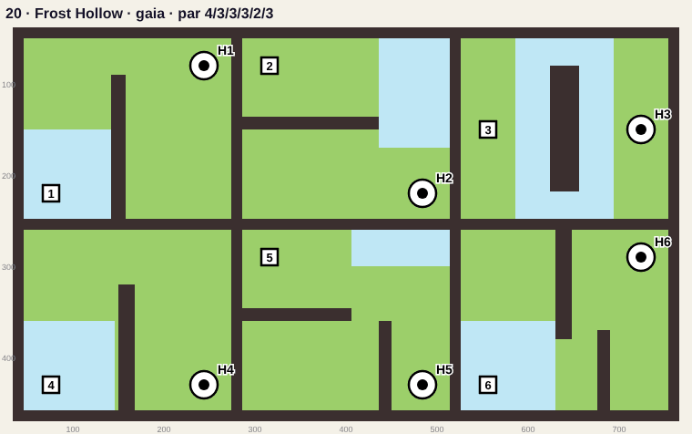

- **Mechanics:** walls and six ice sheets.
- **Par:** 4, 3, 3, 3, 2, 3 (18). R 1 on every putt. B4: 287–1084.
- **Problems:**
  - Its tee/cup pairs are exactly Dune Serpent's.
  - Ice mostly sits under the tee or in a corner: putt 1 tees on ice (46,146); putt 4's sheet (46,356) is under the tee; putt 6's (526,356) is under the tee. Ice under the tee changes almost nothing.
  - Putt 3 is the best idea in the map: an ice channel (586,46 108×198) around a central pillar.
  - Par 4 on putt 1 with a robust ace is three strokes of slack.
- **Scores:** fun 2 · clarity 4 · fairness 4 · variety 2.
- **Verdict:** **rework**. Keep the polar slot and putt 3, and make the ice the route (lanes, banks and slick downhills).

### 21 · Slime Springs: wetland

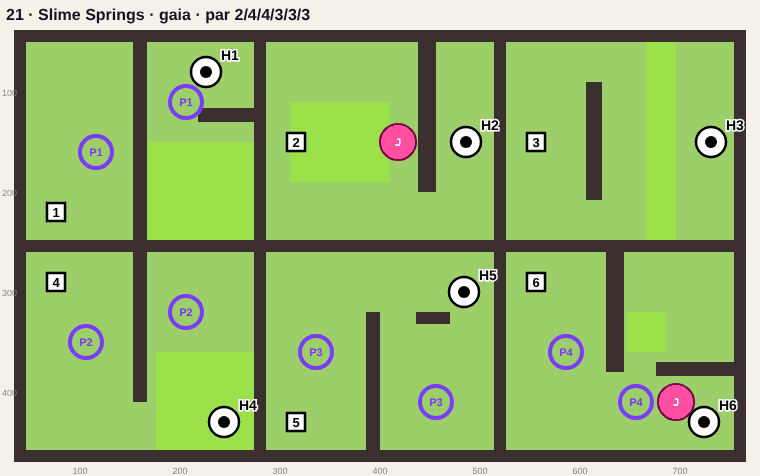

- **Mechanics:** five slime patches, four portal pairs and two pads.
- **Par:** 2, 4, 4, 3, 3, 3 (19). R 1 on every putt. B4: 211–1062.
- **Problems:**
  - Its interior walls are Grand Finale's, and so are its pads and two of its portal pairs.
  - Putts 1, 4, 5 and 6 each have their own portal pair beside the tee, and every one is optional.
  - Slime sits in corners (putt 1's 168,146 106×98) rather than on lines.
  - Par 4 on putts 2 and 3 with robust aces.
- **Scores:** fun 2 · clarity 3 · fairness 4 · variety 2.
- **Verdict:** **replace**. The wetland region needs its own layout; slime should be a sticky choice on the route.

### 22 · Sandstorm Spire: desert (VIS-G)

- **Mechanics:** pillar slalom, a ramp over a dry wash (pit), a wind gully (586,46 108×198, pushing south at 150), a pad onto a walled cup box, and a dust devil.
- **Par:** 2 on all six (12). R 1/1/1/1/1/1.
- **Problems:**
  - The best-themed Gaia map, with a different idea on every putt.
  - Every putt is an ace for a precise player, so par 2 everywhere means no putt asks for a plan.
  - Putt 2 is a min-power straight tap over the ramp (route 0°, power 0.45).
  - Putt 6's tornado (638,360 r44) sits on the line, but the route goes straight through it.
- **Scores:** fun 3 · clarity 4 · fairness 4 · variety 4.
- **Verdict:** **keep with tweaks**. Add one or two genuine par-3 putts (longer, with a lay-up choice) and give the gully wind a visible cue.

### 23 · Obsidian Spiral: volcanic (VIS-G)

- **Mechanics:** lava lanes (pits), a wall spiral, a ramp over a lava river, a pad over a basalt flow, an ice bridge between lava, and a cup inside a broken lava ring.
- **Par:** 3, 2, 2, 2, 2, 2 (13). R 2/1/1/1/1/1.
- **Problems:**
  - Putt 5 is an ice bridge (326,318 150×74) between two lava pits, played as a straight min-power shot (0°, 0.3).
  - Putt 3 is the same ramp-over-pit straight shot as Sandstorm Spire putt 2.
  - Putt 6's broken lava ring around the cup (596–684, 311–399) is the most interesting cup in Gaia.
  - Lava is only a black pit; it does not look or behave like lava.
- **Scores:** fun 3 · clarity 4 · fairness 4 · variety 4.
- **Verdict:** **keep with tweaks**. Replace putt 3 (duplicate idea) and make putt 5 diagonal or curved so the ice matters.
